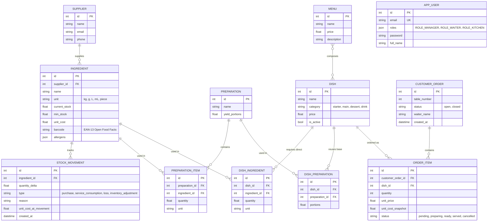

# Data Model — Restaurant Management (`Le Bistro 60`)

## Entity-Relationship Diagram (Mermaid)

## Explanation of Modeling Choices

1. **Separating Direct Ingredients (`DishIngredient`) and Base Preparations (`Preparation` / `DishPreparation`)**:
   - In a real kitchen, chefs prepare shared bases (e.g., *Classic Tomato Sauce*, *Béchamel*, *Pizza Dough*, *Rich Beef Stock*) in batches of $N$ portions (`yieldPortions`).
   - Modeling `Preparation` with its own `PreparationItem` recipe lines and linking `Dish` to `Preparation` via `DishPreparation` avoids duplicating recipe ingredients across multiple dishes while allowing exact cost and stock deduction per portion served.
2. **Explicit Unit Storage & Conversion (`UnitConverter`)**:
   - Each `Ingredient` stores its stock and unit cost in a canonical unit (`kg`, `g`, `L`, `mL`, or `piece`), while recipe lines (`DishIngredient`, `PreparationItem`) can specify convenient culinary units (e.g., `150 g` of Mozzarella on a dish when Mozzarella is stocked in `kg`).
   - `UnitConverter` converts between compatible units within the same physical dimension (`mass`, `volume`, `count`) and rejects invalid cross-dimension conversions.
3. **Immutable Audit Trail (`StockMovement`) + Historical Cost Snapshot (`OrderItem.unitCostSnapshot`)**:
   - Every change to `Ingredient.currentStock`—whether from supplier purchases (`purchase`), serving dishes (`service_consumption`), kitchen waste (`loss`), or physical counts (`inventory_adjustment`)—is recorded as an immutable `StockMovement` with `unitCostAtMovement`.
   - When an `OrderItem` transitions to `served`, `unitCostSnapshot` stores the exact recipe cost at that moment so future ingredient purchase price fluctuations never distort past margin reports.
